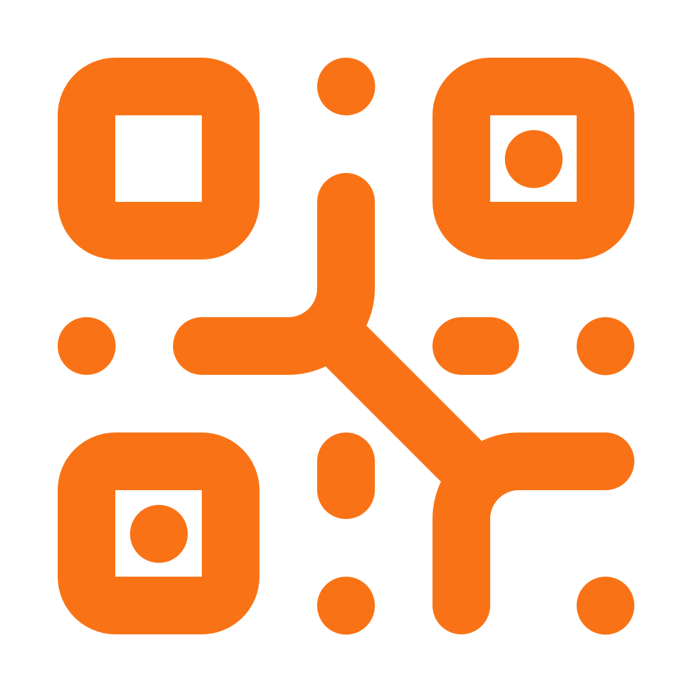

<h1 align="center">
    
</h1>

I build systems end to end that just work.

 **[Yamgi](https://yamgi.com)**: QR menu SaaS for restaurants and cafes, with AI-written descriptions and menus in 19+ languages.

 **[Yaltri](https://github.com/emrebal98/yaltri)**: Tray toolbox for Windows and Linux with search and a color picker, written in Rust.

📫 [LinkedIn](https://linkedin.com/in/emrebal98) · [98emrebal@gmail.com](mailto:98emrebal@gmail.com)
